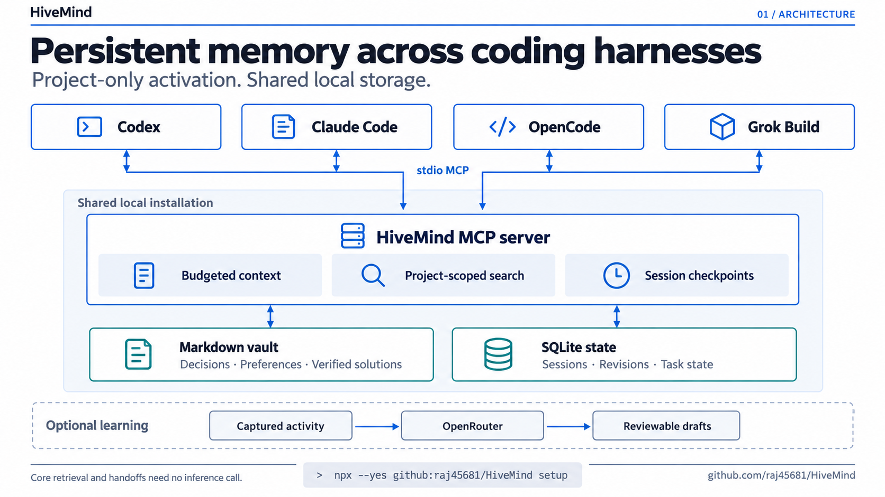
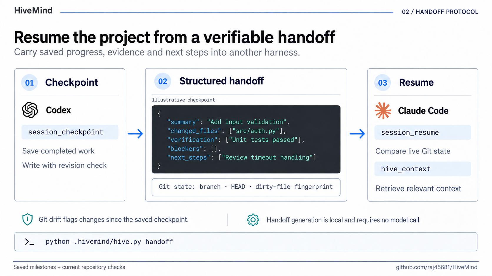
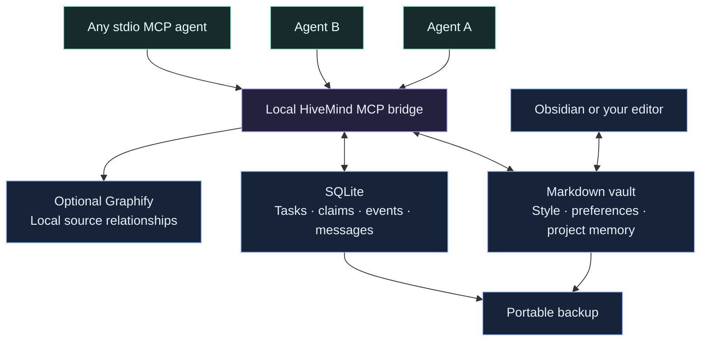

<div align="center">



**Local shared memory and coordination for any stdio MCP agent.**<br>
Guided setup activates HiveMind inside enrolled projects while keeping one shared vault.
Keep your preferences, project context, and hard-won solutions in one local folder.

    [](LICENSE)

[](https://m8ven.ai/mcp/raj45681-hivemind-1ffwv0)

[Quick start](#quick-start) · [How it works](#how-it-works) · [Connect an agent](docs/other-harnesses.md) · [Your memory](#your-memory) · [Backups](#back-up--move-devices) · [Documentation](#documentation)

</div>

---

## The idea

You finish a task with one agent. Later, another agent opens the same project
and retrieves what changed, why it changed, and what still needs attention. In
your next project, confirmed preferences and relevant solutions are available
again.

HiveMind makes that handoff possible through **shared files and a local MCP server**.
It gives each agent a small, relevant brief and a place to save what it learns.



**HiveMind is single-device software.** One Markdown vault and one SQLite database
serve the agents working on that computer. There is no device-sync requirement,
sync daemon, hosted memory bill, or cross-device conflict to resolve. Move to a
different computer with a backup when needed; do not run two active copies of the
same Hive. Existing remote connectors remain optional legacy paths, not the core
product.

| Remember | Coordinate | Own |
| :--- | :--- | :--- |
| Shared personality and working style | Targeted messages between agents | Plain Markdown you can edit |
| Confirmed preferences across projects | Tasks with explicit ownership | Local SQLite task history |
| Project decisions and verified solutions | Concise, persistent handoffs | Portable backups without hosting |
| Saved note versions and local audits | Searchable task and session history | One SQLite authority on this device |

**Now with budgeted briefs and resumable sessions:** select a context budget,
retrieve complete project-aware excerpts, and carry structured checkpoints between
agents. The optional CLI wrapper also captures Git state when an agent exits.
[Explore context & sessions →](docs/context-and-sessions.md)

**Optional code intelligence:** Graphify builds a local map of code relationships.
Agents query it through one bounded HiveMind tool, with no indexing model or API key.
[Explore local code graphs →](docs/code-graphs.md)

**Optional semantic recall:** a local embedding model can find a past solution even
when your new question uses different words. It joins keyword search inside the
existing memory tools; the vault remains plain Markdown.
[Explore semantic memory →](docs/semantic-memory.md)

**Optional free or cheap model learning:** explicitly enable OpenRouter-assisted progress
summaries, taste and working-style candidates, and source-linked knowledge drafts.
Native adapters for eight clients record supported activity locally; bounded
inference suggests learning for review. Free mode has no paid fallback. This feature sends selected activity to
an external provider and requires an API key. Core memory needs neither.
[Set up assisted learning →](docs/assisted-learning.md)

**Compact handoffs without another model call:** `hive.py handoff PROJECT` brings
the last meaningful checkpoint, reported checks, blockers, next actions and new
local activity into one bounded packet. The recorder coalesces bursts, skips
empty/checkpoint-only inference and reports actual OpenRouter token usage.
[Handoff commands →](docs/context-and-sessions.md#structured-handoffs)

**Git-aware continuation:** checkpoints record the branch, commit and a fingerprint
of staged, unstaged and untracked changes. Resume checks the live worktree before
the next harness relies on that handoff. Optional recovery snapshots preserve
bounded file copies; Git metadata alone does not save file contents. HiveMind
does not automatically commit, push or synchronize code between devices.
[Git checks and recovery →](docs/context-and-sessions.md#structured-handoffs)

**Current knowledge for the task at hand:** link memory to affected files, mark old
decisions replaced, and flag competing current claims. Task briefs include relevant
file-linked notes and dependency evidence. Completed work produces reviewable lessons,
and consolidation proposals combine related learning while retaining source history.
Goal plans connect tasks into bounded dependency graphs with explicit agent execution.
[Explore core memory and goal workflows →](docs/core-workflows.md)

> **Local memory, normal agent accounts.** HiveMind needs no hosting subscription
> or embedding service. Semantic recall is an optional local model downloaded once.
> Your AI agents still use their own services and account allowances. Retrieved
> memory uses normal context tokens.

**One-command guided setup:** run HiveMind from your project's terminal, pick
the features and clients you want, and start working. It enrolls the project,
configures project connections, and checks the MCP bridge. Each project keeps its
own learning/model/budget choices. User-wide client registration is never a fallback.
[Set up HiveMind →](#quick-start)

## Quick start

You need **Node.js 20+** for npm/npx, **Python 3.11+**, **Git**, and an agent that
supports stdio MCP. A manual Git install is also available without Node.js. Guided
setup can register recognized installed CLIs; other clients use the manual
connection details. The first setup downloads the Python dependencies. This source
repository is public, so cloning it needs no GitHub sign-in. Your personal vault
and device credentials remain local and are excluded from Git.

Install the HiveMind software once, then opt in from each project's folder.
The vault, checkpoints and private API key stay in that shared HiveMind folder;
activation files live in the enrolled project. Other folders receive no settings.
[Project layout, commands and migration →](docs/project-installation.md)

### 1 · Install from your project folder

Open a terminal in the project you want to enroll and run:

```sh
npx --yes github:raj45681/HiveMind setup
```

Or add the launcher as a project development dependency:

```sh
npm install --save-dev github:raj45681/HiveMind
npx hivemind setup
```

This is a GitHub package install, not a published npm-registry name. The launcher
opens the same guided harness, free-model and hidden OpenRouter-key setup.
`npm install` itself does not run setup or ask for credentials. Python's private
environment and pinned dependencies are prepared automatically by the setup command.
Activation remains project-only. The shared backend, vault and keys live outside
`node_modules` and npm's cache; removing the npm package does not remove memory.

To reuse an existing HiveMind folder on your first npm run, select it explicitly:

```sh
npx --yes github:raj45681/HiveMind setup --hive-home "D:\HiveMind"
```

Later projects reuse the remembered home. On a fresh device, the shared home is
`~/.hivemind/home`. Run the same setup command inside each project you want to
enroll. See [npm setup and storage](docs/npm-setup.md) for requirements, updates
and additional options.

<details>
<summary><strong>Alternative: manual Git install without npm</strong></summary>

Open **CMD in the project you want to work on** and paste this single line:

```cmd
(if not exist "%USERPROFILE%\HiveMind\hivemind.cmd" call git clone https://github.com/raj45681/HiveMind.git "%USERPROFILE%\HiveMind") & call "%USERPROFILE%\HiveMind\hivemind.cmd"
```

Already have HiveMind installed? From any project's CMD prompt:

```cmd
"%USERPROFILE%\HiveMind\hivemind.cmd"
```

For PowerShell and Linux commands, see the
[project installation guide](docs/project-installation.md#manual-git-install).
Use either the npm method or this manual method; both open the same wizard.

</details>

The setup command opens the wizard. On the first interactive run, choose what
to include:

| Choice | Setup |
| :--- | :--- |
| **0 · Core** | Shared Markdown memory, SQLite task state, and MCP bridge |
| **1 · Semantic** | Core plus local paraphrase recall |
| **2 · Graphify** | Core plus local code relationships (Python 3.12+) |
| **3 · Both** | Core, semantic recall, and Graphify |
| **4 · All** | Both extras plus two optional working-style questions |
| **5 · Other MCP client** | Core memory with manual stdio connection details |

Semantic recall downloads a local model; Graphify downloads an isolated
dependency. HiveMind saves your semantic and Graphify choices on this device.
For the next project, run the same command from that project's terminal; it
reuses the local feature choices. A project wizard then asks for clients,
learning mode, OpenRouter model and budget, activity capture, and optional
project purpose and working preference. Interactive setup always explicitly asks
for the OpenRouter API key when learning is enabled, even if one already exists.
Input is hidden; Enter keeps the existing key or skips entry when none is set.
Pasted keys are saved privately on this device, outside Git and the vault.
The **All** option saves only the
working-style answers you actually enter. Setup makes no paid agent call.

Free learning offers six model choices with automatic free fallback routing.
Temporary failures retry up to three attempts total, with short backoff and
OpenRouter's `Retry-After` delays. Every HTTP retry respects the shared request
budget. See the [model pool and retry policy](docs/assisted-learning.md#model-budgets-and-failure-behavior).

Setup is safe to rerun. Saved project choices avoid repeated option
questions; the OpenRouter key step remains explicit during interactive learning
setup. `--configure` reopens the other options; `--no-prompt` skips all questions.
Setup configures each selected client independently,
then opens the local MCP bridge and calls `hive_context` without starting an AI
session. The report separates MCP configuration, native capture and headless task
execution. **Configured** means settings are installed; actual client callbacks
still need a restart and normal trust. If one adapter fails, the others are attempted.
Codex and Grok use project-local MCP configuration and hooks. Cline CLI uses a
project launcher; Antigravity and Windsurf use the local CLI fallback because
their current adapters do not provide native project-only MCP activation.
Setup succeeds with no recognized CLI when the local bridge passes its probe;
it prints the command and project-instruction path for another stdio MCP client.
Choose **5** on a fresh interactive setup, or add `--other-client` to an explicit
command. You can combine `--other-client` with `--with-semantic` and `--with-graphify`.

To reopen the menu and change the defaults for future projects, run this from
the project you are setting up:

```sh
npx --yes github:raj45681/HiveMind setup --configure
```

If you installed HiveMind before the guided menu was added, use `--configure`
once to set your defaults.

After enrollment, use the helper inside your project:

```cmd
.hivemind\hive.cmd handoff
.hivemind\hive.cmd context --query "current task"
.hivemind\hive.cmd setup --configure
```

The helper supplies the project ID and follows the ignored local pointer to the
same shared vault. On Linux use `python3 .hivemind/hive.py` or `bash .hivemind/hive`.
Existing global registrations from older releases require the explicit
[one-time migration](docs/project-installation.md#migrate-an-existing-global-installation).

Supported adapters cover Codex, Grok Build, Antigravity, Claude Code, OpenCode,
Command Code, Gemini CLI, Cursor, Copilot CLI, VS Code, Cline, Roo Code, Continue
and Windsurf. [Capabilities, scope and configuration paths →](docs/harness-setup.md)

For explicit project setup without questions (using an existing key):

```cmd
"%USERPROFILE%\HiveMind\hivemind.cmd" "D:\Projects\My App" --no-prompt --harness claude --harness opencode --learning free --daily-limit 100 --capture
```

You can also run `.venv\Scripts\python.exe hive.py setup PROJECT` from the
HiveMind folder. Free learning is the default model when enabled; cheap mode
requires an explicit model, daily dollar ceiling and provider price ceilings.
Native capture can be off independently of explicit MCP checkpoint learning.

Recognized adapters need no separate skill. Other clients
need the printed stdio command in their own MCP settings. Restart any agent
session that was open during setup so it can load the new bridge.

Setup checks installed bridge package versions against `requirements.txt` on
every run and repairs missing or mismatched pins. `hive.py doctor` reports the
required and installed versions without installing anything.

<details>
<summary><strong>Advanced: unattended setup and per-run feature flags</strong></summary>

For scripts or unattended setup, add `--no-prompt` to use saved defaults (core
only on a fresh install). `--with-semantic` and `--with-graphify` add a feature
for one run without opening the menu. Add `--personalize` when you only want
the working-style questions. Changing defaults does not uninstall an already
installed model or disable Graphify in existing projects.

Or specify the project explicitly:

```cmd
"%USERPROFILE%\HiveMind\hivemind.cmd" "D:\Projects\My App"
```

To include **local Graphify code indexing** (Python 3.12+, first setup downloads dependencies):

```cmd
"%USERPROFILE%\HiveMind\hivemind.cmd" "D:\Projects\My App" --with-graphify
```

To include **local semantic memory** (first setup downloads an isolated model):

```cmd
"%USERPROFILE%\HiveMind\hivemind.cmd" "D:\Projects\My App" --with-semantic
```

Once installed on the coordinator device, semantic recall works for **every
enrolled project** through the existing `memory_search` and `hive_context` tools.
No agent skill or extra MCP tool is needed. Combine both flags if you want
Graphify as well. [Setup, privacy and limits →](docs/semantic-memory.md)

Use `--tool-profile memory` to expose eleven memory, review, and session MCP tools on
this device. The default `full` profile exposes 22 core tools, including task
claims, goals, and messages, plus optional Graphify. The memory profile reduces
serialized tool schemas; `hive.py benchmark` reports the current sizes, while
prompt-token savings depend on the client. Override one generic client's profile
with `hive.py client-info PROJECT --profile memory`, or run the bridge with
`hive.py serve --profile memory`. Restart clients after changing the profile.

Run the same command for each new project **on this device**. Source-only graphs
are rebuilt locally; preferences and handoffs stay in the same vault. Memory-only
setup still works without Graphify. [Supported files, limits and recovery →](docs/code-graphs.md)

</details>

<details>
<summary><strong>PowerShell and Linux commands</strong></summary>

PowerShell, after cloning to your home folder:

```powershell
& "$HOME\HiveMind\hivemind.cmd"
```

Linux, from your project's folder:

```bash
git clone https://github.com/raj45681/HiveMind.git "$HOME/HiveMind" && python3 "$HOME/HiveMind/bootstrap.py"
```

Subsequent projects:

```bash
python3 "$HOME/HiveMind/bootstrap.py"
```

Linux may need its distribution's Python `venv` package. Windows has been tested
locally; the portable code has not yet been exercised on a physical Linux device.

</details>

### 2 · Restart your agent session

Setup writes project-local connections for supported clients and reports launcher
or CLI fallbacks for the others. It never silently edits user-wide client settings.
It adds a managed workflow to `AGENTS.md`, handles an existing
`AGENTS.override.md`, and adds a pointer to an existing `GEMINI.md`.

Existing instructions are preserved and backed up. Reruns update the managed
section without duplicating it. Accept normal project-trust and MCP prompts from
your client. Missing CLIs are skipped.
The bridge probe verifies the server itself; it cannot verify that an already-open
client session has reloaded its MCP configuration.

Any stdio MCP client can join the same memory and task state. Run
`hive.py client-info PROJECT` for their local connection command, then load the
project’s `AGENTS.md` workflow in that client. Context and session tools accept a
stable lowercase client ID; automatic registration and queued headless execution
are limited to verified CLI adapters. [Connect another agent →](docs/other-harnesses.md)

### 3 · Work as usual

Agents are instructed to retrieve context before substantial work, save verified
learning at milestones, and leave a handoff. You do not need to repeat
“use HiveMind” for every task in an enrolled project.

**This is an instruction-based workflow.** Agents must follow the rules and have
access to the tools. HiveMind does not silently capture every chat, guarantee
model compliance, or automatically launch another agent.

### Verify the handoff path

From the HiveMind folder, run this after setup or an update:

```cmd
.venv\Scripts\python.exe hive.py verify
```

`verify` creates a disposable vault and Git project. It starts two separate MCP
server processes, saves memory and a session checkpoint in the first, then checks
that a fresh context retrieves the right project note and handoff within a
1,000 estimated-token budget. It also checks safe memory retry, project
isolation, and Git drift detection. The command returns a nonzero exit code on
failure and uses **no paid agent/model calls**. Your real vault and projects are
untouched. On Linux use `.venv/bin/python`.

This proves the local protocol path, not that a vendor client has loaded its
registration or will follow the project instructions. The onboarding report
checks registration; restart the client and ask it to call `hive_context` to
check its live session.

For a repeatable retrieval check, run `.venv\Scripts\python.exe hive.py benchmark`
from the HiveMind folder (`.venv/bin/python hive.py benchmark` on Linux). It uses a
disposable synthetic vault to report exact and paraphrase recall, unrelated and
wrong-project results, 512/1000/1800-token context inclusion, latency, response
bytes, and full versus memory tool-schema bytes. `--distractors 500` increases
vault size. `--semantic` reuses an installed local model cache without a download
or paid agent call. The fixture does not measure your private vault or guarantee
a vendor client's behavior.

The benchmark includes 17 labelled cases: exact queries, paraphrases, ambiguous
terms, conflicting archived advice, pending preferences, review drafts, unrelated
queries, and literal project boundaries. It reports rank and incremental indexing
work as well as retrieval results. Add `--check` to return a nonzero exit code on
required retrieval, isolation, indexing, or context-budget regressions. Core mode
reports paraphrase misses without failing; `--semantic --check` requires those
paraphrases to be found too.

## How it works



| When | What happens |
| :--- | :--- |
| **Start a task** | Fetch a bounded brief: shared style, confirmed preferences, project state, and relevant search matches. |
| **Reach a milestone** | Record a verified solution, reusable procedure or scoped decision with its source and evidence. |
| **Finish work** | Update project state and leave a concise handoff for the next agent. |
| **Switch projects** | Reuse confirmed preferences; search for applicable past solutions. Project choices stay scoped. |

**Small context by design:** configurable briefs (default 1800 estimated tokens),
query-matched notes packed before the remaining standing context, complete excerpts
ranked by project, relevance and freshness, revision-checked writes,
and no model-driven queue polling. Optional semantic search runs local embedding
inference only; it makes no paid agent or hosted API calls. Other search and
coordination remain deterministic;
reading the returned text still consumes context. Inferred tastes stay separate
from confirmed preferences. Current instructions always take precedence over memory.

Candidate review, checkpoint review, procedure maintenance, history, audit and older
handoff search are **on demand**. Core memory relationships and learning proposals
have dedicated MCP tools. Agents can save verified procedures through `memory_learn`;
inferred preferences need explicit local approval before they enter the profile.
[Use local memory operations →](docs/local-memory-operations.md)

### One server, up to 23 tools

HiveMind registers **one MCP server** with each agent. That server exposes 22 core
tools, plus `code_query` on devices with Graphify-enabled projects:

| Purpose | Tools | Count |
| :--- | :--- | ---: |
| Memory | `hive_context`, `memory_search`, `note_read`, `memory_write`, `memory_learn` | 5 |
| Memory lifecycle | `memory_relate`, `memory_consolidate`, `learning_review` | 3 |
| Sessions | `session_start`, `session_checkpoint`, `session_resume` | 3 |
| Tasks | `task_create`, `task_get`, `task_list`, `task_claim`, `task_heartbeat`, `task_finish` | 6 |
| Goals | `goal_create`, `goal_status`, `goal_control` | 3 |
| Messages | `message_send`, `message_inbox` | 2 |
| Optional code graph | `code_query` | 1 |

The MCP `tools/list` response distinguishes reads from writes with explicit
`readOnlyHint` annotations. New sessions, tasks and messages are marked additive;
checkpoints, memory updates and task-state changes are marked as mutations.
`code_query` can refresh its disposable local index, so it is marked as a
non-destructive write even though it does not edit source files. These are client
hints, not an access-control boundary; the server still validates every write.

The local authority's `tools/list` response explicitly classifies retries for every write:

| `idempotentHint` | Tools | Meaning |
| :--- | :--- | :--- |
| `true` | `session_checkpoint`, `memory_write`, `memory_learn`, `task_finish` | Repeating the same arguments cannot add another persisted change. `memory_learn` or `task_finish` may still return a conflict or ownership error; read the saved note or task to confirm the first result. |
| `false` | `session_start`, `task_create`, `task_claim`, `task_heartbeat`, `message_send`, `memory_relate`, `memory_consolidate`, `learning_review`, `goal_create`, `goal_control`, optional `code_query` | A repeat may add or change state, or return a revision conflict. Stable keys prevent duplicate goal plans and proposals; inspect the saved result before retrying a mutation. `session_start` is retry-safe only when the caller supplies a stable `session_id`. |

Read-only tools leave `idempotentHint` unset because the hint only applies to
environment-changing tools. An idempotency hint describes repeated effects, not
an identical response or a guarantee that the first call succeeded. A forwarding
bridge conservatively marks writes non-idempotent because it cannot verify an
older authority's behavior; legacy cloud-memory writes are treated the same way.

Task and messaging tools support explicit coordination; their presence does not
launch other agents. The full profile exposes coordination tools; the memory profile
exposes only recall and memory tools. Select it during setup with `--tool-profile memory`.

**When Graphify runs:** selecting it in setup or using `--with-graphify` builds the initial index.
Subsequent `code_query` calls check for source changes and refresh as needed.
It does not run continuously or after every message. Agents are instructed to use
it for code relationships; preferences and handoffs use the memory/session tools.
[Invocation details →](docs/code-graphs.md#when-graphify-runs)

**Token overhead:** semantic indexing uses your CPU, not agent tokens. Tool definitions,
project instructions and returned text still add context to the agent. The 1,800-token
memory brief and 1,000-token code-query defaults are approximate response ceilings,
not fixed per-task charges or limits on the entire conversation. Actual usage depends
on the harness, tokenizer, caching and number of calls. Net savings from fewer file
reads have not yet been measured in a paid-agent task.

## Your memory

```text
HiveMind/
├── hivemind.cmd          Windows project installer
├── bootstrap.py          Portable first-run setup
├── hive.py               CLI + MCP entry point
├── hivemind/             Memory, coordination, and execution
├── templates/vault/      Generic starter notes tracked in Git
├── vault/                Your private local notes — ignored by Git
│   ├── 00-System/        Personality and working style
│   ├── 01-Memory/        Preferences and reusable solutions
│   ├── 02-Decisions/     Decisions and reasons
│   ├── 03-Projects/      Project state and handoffs
│   ├── 04-Tasks/         Generated task views
│   └── 05-Agents/        Agent roles
├── runtime/              Private SQLite database, note versions, logs, and config backups
└── tests/                Automated tests without paid inference
```

Open **`vault/` as an Obsidian vault**, then open `START`. No community plugin is
required, and Obsidian does not need to be running. Edit `00-System/Personality.md`
and `00-System/Working-Style.md` to define how your agents should work.

Session checkpoints retain completed work, reported checks, blockers and next
steps in SQLite, with a Markdown view under each project's `Sessions/` directory.
Concurrent updates require revision checks, and a CLI exit alone is never treated
as verified completion. Resume compares each saved Git/worktree fingerprint with
the live state and flags changed or unverifiable handoffs for inspection.
[Session behavior and limitations](docs/context-and-sessions.md).

**Opt-in worktree recovery** saves bounded private file snapshots at session
milestones. Preview a changed file, restore it only while its current hash matches
the preview, and undo that restore if needed. [Setup and limits →](docs/recovery-snapshots.md)

Saved Markdown revisions can be inspected, diffed and restored with a current-revision
check. A read-only audit flags mechanical issues; an opt-in search finds older task,
session and message handoffs. These local operations make no model calls.
[Commands and limits →](docs/local-memory-operations.md)

The repository ships generic templates. First setup creates missing local notes
without replacing your edits. **Your real vault, credentials, databases, device
configuration, and backup ZIPs are excluded from Git.** Cloning this repository
installs the software; it does not restore your personal memory.

## Back up & move devices

From your HiveMind folder, after stopping active agent sessions and task workers:

```cmd
.venv\Scripts\python.exe hive.py backup "D:\Backups\HiveMind-2026-09-25.zip"
```

Choose a new filename each time. Existing backups are never overwritten.

| Included in a personal backup | Recreated or transferred separately |
| :--- | :--- |
| Source and starter templates | Python environment and dependencies |
| Vault notes and attachments | Agent logins and credentials |
| Consistent SQLite snapshot | Device-specific repository paths |
| Task history and messages | Working code, worktrees, run logs, and cloud cache |

Extract the ZIP's `HiveMind` folder onto the next device. Install Python and your
agent CLIs, then run its installer in each project. Keep the project's tracked
`.hivemind/project.json` to preserve its identity. Restart agent sessions.

**Use one active copy.** Moving devices is migration, not live synchronization.
Move a fresh backup when switching devices; do not sync a live SQLite database
with a generic folder-sync tool. Personal backups contain private data—keep them
out of GitHub releases and repository commits.

## Useful commands

Run these from your HiveMind folder. On Linux substitute `.venv/bin/python`.

```cmd
.venv\Scripts\python.exe hive.py doctor
.venv\Scripts\python.exe hive.py status
.venv\Scripts\python.exe hive.py search "authentication"
.venv\Scripts\python.exe hive.py offline
.venv\Scripts\python.exe hive.py context myapp --query "login" --budget 1000
.venv\Scripts\python.exe hive.py resume myapp
.venv\Scripts\python.exe hive.py handoff myapp
.venv\Scripts\python.exe hive.py assist-status --project myapp
.venv\Scripts\python.exe hive.py history "01-Memory/Solutions/my-fix.md"
.venv\Scripts\python.exe hive.py memory-audit --project myapp
.venv\Scripts\python.exe hive.py handoff-search "authentication" --project myapp
```

The installer also supports `--dry-run`, `--name myapp`, `--skip-register`,
`--configure`, and `--no-prompt`.

For an explicitly launched interactive session with automatic exit capture:

```cmd
.venv\Scripts\python.exe hive.py session-run myapp AGENT-CLI
```

Replace `AGENT-CLI` with an installed CLI name or a locally configured adapter.
This uses that agent's normal account usage.
Normal agent launches still work; their handoff capture depends on following the
installed instructions. The context budget is an estimate for the returned brief,
not a hard limit on the agent's full conversation or account usage.

<details>
<summary><strong>Optional: explicitly queue and run an agent task</strong></summary>

```cmd
.venv\Scripts\python.exe hive.py create examples\inspect-project.json
.venv\Scripts\python.exe hive.py run TASK-ID --dry-run
```

Replace `TASK-ID` with the returned ID. Remove `--dry-run` only when you intend
to execute the task using the assigned agent's account. Creating tasks or sending
messages does not wake a model.

Tasks use claims and leases to prevent duplicate ownership. Write tasks require
a clean Git repository with a committed HEAD and run in an isolated worktree.
Expired leases display as blocked even on read-only task views; the next coordinator
write records the expiry event. Inspect before explicitly requeuing. Reported evidence needs
review; nothing automatically merges, pushes, or deploys code.

</details>

## Development

```cmd
.venv\Scripts\python.exe -m unittest discover -s tests -v
```

Tests cover memory conflicts, ownership and leases, worker result handling, MCP
interoperability, project-rule preservation, offline routing, backup restoration,
private-vault separation, client setup, recorder batching and crash recovery,
token accounting, and model-free handoffs. They use temporary fixtures, simulated
provider responses and local child processes, with no paid model calls.

The protocol suite verifies tool behavior, not a model's instruction compliance.
Real vendor inference and physical Linux behavior need separate smoke tests.

GitHub Actions runs the unit suite, `doctor`, the MCP acceptance check, and the
retrieval regression benchmark on Windows and Linux with Python 3.11, 3.12, and
3.13. Each job uploads its benchmark JSON. A manual workflow run can also enable
the real semantic-model tests and benchmark; this downloads or reuses the local
model cache and makes no paid inference calls.

`hive.py doctor` keeps its JSON output for scripts and exits nonzero when a
required dependency or coordinator check fails. Use `hive.py doctor --human` for
a readable summary with repair commands. Missing optional features do not fail
core health checks; degraded optional features appear as warnings.

Search checks file metadata each time and reads changed notes. Full content
reconciliation occurs on the next scan after five minutes, or immediately with
`hive.py index`. This preserves direct Obsidian edits, deletions, and note history
without rereading an unchanged vault on every query. Filesystem metadata is a
change signal, not proof of identical content; run `index` after tools that
preserve every timestamp and file identity.

Open **`Review`** in the Obsidian vault for pending preference approvals,
checkpoint drafts, and procedures to check. Refresh it with
`hive.py review-dashboard` or `hive.py export`.
[Review workflow and project filters →](docs/local-memory-operations.md#review-dashboard)

## Documentation

| Guide | Read it for |
| :--- | :--- |
| [npm and npx installation](docs/npm-setup.md) | Guided setup, requirements, shared storage and software updates |
| [Project installation](docs/project-installation.md) | Manual Git installation, project helpers and migration from global activation |
| [Harness setup](docs/harness-setup.md) | Supported clients, project connections, native capture and key entry |
| [Core memory and goal workflows](docs/core-workflows.md) | Current decisions, task-aware context, consolidation, outcome learning, and bounded goal execution |
| [Budgeted context & session handoffs](docs/context-and-sessions.md) | Smaller briefs, checkpoints, resume, and optional CLI exit capture |
| [Optional local code graphs](docs/code-graphs.md) | Graphify setup, bounded queries, supported files and fallback behavior |
| [Optional semantic memory](docs/semantic-memory.md) | Paraphrase recall, one-time model setup, local index and limits |
| [Local memory inspection](docs/local-memory-operations.md) | Note history, safe restore, read-only audit, and handoff search |
| [Worktree recovery snapshots](docs/recovery-snapshots.md) | Opt-in capture, diff preview, conflict-checked file restore and undo |
| [Device migration](docs/new-device.md) | Moving a local Hive with a backup; legacy remote configuration |
| [Optional cloud bridge](docs/cloud-memory.md) | Legacy cloud integration; inactive in local mode |
| [Implementation references](docs/sources.md) | Protocol and CLI references |
| [Agent workflow](AGENTS.md) | Instructions used when developing HiveMind |

## License

HiveMind is licensed under the [MIT License](LICENSE). Keep the copyright and
license notice when redistributing it. Installed third-party dependencies retain
their own licenses.

---

<div align="center">

**Keep the context. Carry the learning. Choose the agent.**

Markdown you can read · SQLite you can back up · A folder you control

</div>
