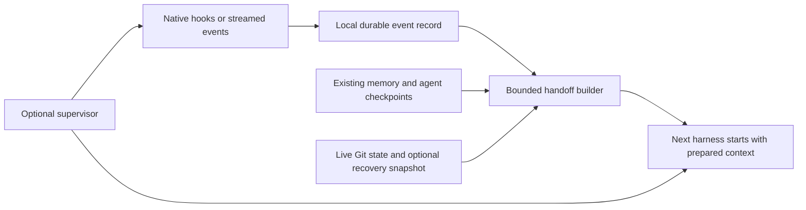

# Automated cross-harness continuity: proposed design

Date: 2026-10-19 (Asia/Calcutta)
Status: original design proposal, now partly implemented. The shipped recorder,
assisted learning and model-free handoff commands are documented in
[assisted learning](assisted-learning.md), [client setup](harness-setup.md) and
[structured handoffs](context-and-sessions.md#structured-handoffs). Automatic
harness switching and an always-on supervisor remain proposed. The interfaces
and commands below describe the original design, not a supported command reference.

## Outcome

A user works in Codex, reaches a usage limit, and continues in Grok Build with
the latest captured request, useful decisions, current files, recorded checks,
and unfinished actions. Saving useful progress must work even when the current
model cannot answer another prompt.

The recommended architecture is an event recorder plus a deterministic handoff
builder, with an optional supervisor for automatic switching. Keep the current
MCP memory and session APIs. No manager model or periodic paid summarizer is
required. Reading a handoff still consumes the destination agent's context.



## Existing foundations and verified interfaces

HiveMind already has revision-checked session checkpoints, project memory,
Git drift checks, optional worktree recovery, and a CLI exit wrapper.
`hivemind/session_runner.py` currently waits for the child process to exit;
it does not continuously record the conversation. `hivemind/worker.py` already
uses structured Codex output, but Grok worker execution currently requests a
final JSON object. A result-only adapter is insufficient for interruption recovery.

Official OpenAI documentation describes prompt, tool, stop, interrupt and session
hooks. Hooks require trust. Transcript paths can be supplied, but their file
format is explicitly unstable. Use supported event fields first and validate the
actual local surface before claiming coverage. [Codex hooks](https://learn.chatgpt.com/docs/hooks)

Codex also documents streaming JSONL execution and an app-server protocol with
rate-limit updates. These are suitable for supervised execution; an independent
client cannot be assumed to observe an already-running desktop session.
[JSONL execution](https://learn.chatgpt.com/docs/non-interactive-mode),
[app-server](https://learn.chatgpt.com/docs/app-server)

Grok documents lifecycle hooks, streamed headless JSON and ACP. Its passive hooks
ignore stdout, so a Grok SessionStart hook must not be assumed to inject a handoff.
Use a launcher-supplied prompt or ACP for dependable initial context delivery.
[Grok hooks](https://docs.x.ai/build/features/hooks),
[streaming and ACP](https://docs.x.ai/build/cli/headless-scripting)

Local help checked without model calls: Codex 0.163.0-alpha.10.2 and Grok 1.0.62.
Both expose machine-readable output. Runtime hook payloads and native UI coverage
still need compatibility tests; documentation is not proof of local delivery.

## 1. Record events independently of the model

Install a small local Python command handler during opt-in continuity setup.
It writes directly to local storage; it must not require a functioning MCP
connection, a model response, or a final shutdown callback. Preserve existing
hook definitions and use each client's normal trust flow.

Capture the submitted user request immediately, then supported visible assistant
messages, tool starts/results, turn boundaries, interruptions and errors. Preserve
source roles and provenance. Record a tool start before its completion so an
interrupted action remains visibly unresolved. Do not collect hidden reasoning.
Do not assume hooks expose every tool output: each adapter declares exactly which
fields and events it can supply.

Add event tables to the existing authoritative `runtime/hivemind.db`, with a
portable work ID, Hive session ID, native harness/session/turn IDs, adapter version,
source cursor, timestamps and event type. Keep event data outside the vault and
Git. Enable capture only for enrolled projects and explicitly selected sessions;
do not crawl unrelated histories.

Commit each critical event in a short transaction. Persist the replay cursor
with the event. Use source IDs/cursors for idempotence, not content-only deduplication:
two identical user prompts can be two real requests. If storage is busy, use a
bounded atomic disk spool and report its state; replay it on the next invocation.
Disk-full and recording failures must be visible.

Bound event sizes and retention, redact known credential patterns, and retain
large outputs by local reference plus bounded excerpts. Redaction cannot prove
that all secrets are removed. Cross-provider packets should contain only the
task-relevant, selected record. Old transcripts remain historical evidence,
not new instructions or standing permission.

## 2. Build useful context without another model call

After turn boundaries and important tools, refresh a machine-observed progress
record. Debounce Git reads; do not snapshot the entire repository after every
token. Request existing optional recovery captures at useful file milestones,
subject to current size and exclusion rules. Never auto-restore over live edits.

Keep this record separate from agent-authored checkpoints. The current
Checkpoint schema has small bounded fields and only agent/worker/wrapper sources;
do not pack an event history into those fields or overwrite a useful semantic
handoff with a generic recorder message.

The handoff builder combines:

- The current user goal and latest corrections, with their source roles.
- The last substantive agent checkpoint and applicable project memory.
- Relevant events since that checkpoint, especially failed or unfinished actions.
- The exact worktree, branch/HEAD and live Git differences.
- Recorded verification commands, results and the file state they tested.
- Uncertainty, capture gaps, pending approvals and references for deeper reading.

Use the existing configurable context budget and disclose omissions. A passing
test before later edits is historical evidence, not verification of the latest
files. Unknown outcomes stay unknown; a process exit never proves task completion.

Improve semantic checkpoints during an ordinary working turn when convenient.
That improves handoff quality, but the recorder and emergency packet cannot
depend on the agent obeying a reminder. A newly available destination agent may
interpret the bounded event tail as part of its normal continuation.

## 3. Support native use and managed switching separately

Native capture mode preserves the user's normal Codex or Grok UI. Hooks save
supported events and the existing MCP workflow supplies context. This does not
give HiveMind ownership of that UI or reliable authority to stop its process.
If callback coverage is missing, report degraded capture rather than advertising
automatic continuity. A versioned, explicitly enabled transcript reader can be
a fallback, with cursor replay and format-change detection.

Managed mode extends `session-run` with a supervisor that owns the source process
and observes its stream. For an initial CLI implementation, use each harness's
streamed execution. A later persistent interface can use Codex app-server and
Grok ACP. Avoid scraping terminal pixels or injecting keystrokes.

Proposed user experience, not current commands:

```text
hive work myapp --agent codex --fallback grok
hive continue myapp --agent grok
```

At startup the launcher explicitly passes a prepared handoff through the new
harness's supported prompt interface, preserving provenance and the current
user instruction's priority. Do not depend solely on the new model remembering
to call MCP. Do not copy vendor-private conversation state between harnesses.

## 4. Switch with a bounded state machine

```text
RUNNING -> HANDOFF_PREPARING -> SOURCE_STOPPED -> READY -> RESUMING
                                    |                       |
                                    +-> NEEDS_ATTENTION <----+
```

If a documented quota signal is available, prepare a handoff before exhaustion
at a configurable threshold. This is advisory: shared account usage and costly
turns can exhaust capacity unexpectedly. Keep recording even without quota data.
Do not infer subscription quota from accumulated token totals.

On a known hard usage-limit error, build the emergency handoff from durable
events. Distinguish quota exhaustion from transient throttling, network failures,
authentication, permission denials and ordinary task/test failures. An unclassified
error may prepare a packet but must not trigger blind switching.

The user selects automatic fallback order and bounds once when enabling this
mode. Before starting the destination, confirm the owned source process and
its writer children have stopped, drain pending events, save the handoff, then
transfer a fenced ownership lease. Only one participating harness may write the
worktree at a time. A lease does not control unrelated editors or agent sessions;
recheck live state and stop if ownership cannot be established.

Persist a switch ID and destination launch receipt so crash recovery does not
launch two agents. Use explicit switch/time/turn limits; an initial policy can
allow one fallback per task. Stop on cancellation, a required user answer,
permission/authentication problems, unsupported adapters, or exhausted fallbacks.
For an interrupted external operation, reconcile its actual status before retrying;
never replay a deployment or other side effect merely because its result is absent.

## Delivery order and acceptance evidence

1. Recorder and capability checks for Codex and Grok, plus a handoff preview.
   Prove that the latest submitted request survives forced source termination,
   repeated hook deliveries do not duplicate events, and parallel sessions do not
   leak across projects. Exercise missing hooks, file rotation and disk failures.
2. Deterministic handoff assembly and an explicit continue launcher. Prove that
   the correct worktree and latest corrections reach the destination, stale
   verification stays labelled, and budget omissions are visible. Use fixture
   CLIs and real local MCP processes without paid models.
3. Opt-in supervised fallback. Test hard quota errors, transient errors, crashes
   before/after lease transfer and launch, child-process shutdown, cancellation,
   exhausted fallbacks, pending approvals and uncertain external actions.
4. Run a small authorized real Codex-to-Grok continuation task, then the reverse.
   Confirm equivalent goal, constraints and file state; do not equate a fixture
   pass with vendor-model compliance. Validate both Windows and Linux behavior.

Success means bounded, explainable recovery from the last durably observed event,
with no dependency on a final model answer and no duplicate participating writer.
It cannot preserve an event the source never exposed, unwritten output lost in a
crash, hidden reasoning, or identical behavior across different models.
